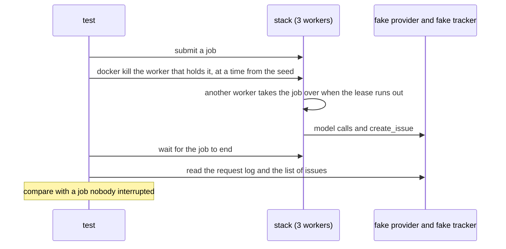

# Results

Each guarantee has a test with a pass line that was fixed before the run, and
a run with the mechanism switched off to show that the test can fail.

The table with one line per guarantee is in the
[README](../README.md#results). The evidence is on two pages:

- [Durability](results-durability.md): surviving a lost worker, unsafe tool
  calls, stale workers, crash loops.
- [Budget, scope and approval](results-controls.md): what a job may spend,
  reach and do.

This page has what the runs share: how a run works, where it ran, and what
it does not show.

## How a kill run works

What happened outside a job is read from records other than the job's step
log. See [Testing](testing.md#records-a-test-trusts).

## The chaos runs

| | |
|---|---|
| Command | `CHAOS_RUNS=200 make chaos` |
| Full run | Commit `256fe08`, 2026-11-13. Review fixes came after it. |
| Short run on the fixes | Commit `665bf6a`, 2026-11-14: 11 of 11 tests, with 20 kill runs and 15 kills sent |
| Runs and seed | 200 runs with a random kill time, seed `20261113`. Every other test: 1 run. |
| Workers | 3 |
| Provider | The fake provider |
| Where | Docker Compose on one machine, Linux aarch64 under WSL2, 8 CPUs |

| Tests | Lease | Scenario |
|---|---|---|
| Kills, failpoints | 2 s, renewed every 0.5 s | `ci-triage-slow`: each answer 0.5 s late |
| Crash loop | 2 s, renewed every 0.5 s | `crash-loop` |
| Pause, stop | The default 30 s, renewed every 10 s | `ci-triage-stall`: two answers 10 s late |

The results of the other guarantees name their own commit and command.

## What these results do not show

- Nothing ran against a real model provider or a real issue tracker.
- Everything ran on one host with one clock. A lost network between a worker
  and the database is covered by an integration test that cuts the database
  sessions, not by a chaos run.
- The runs with a mechanism switched off were read when they ran. Their
  output was not kept.
- The limits the design accepts are in [Known limits](limits.md).

## Runs that do not count

- One earlier run of the pause test had two takeovers instead of one. The
  machine's wall clock moved forward by 36.6 s during the test, which ended
  the second worker's lease early.
- In that run the paused worker still wrote nothing, and the job succeeded
  with one issue. The pause test passed in the run above and in six runs
  before it.
- One short run at `665bf6a` was aborted: the machine was suspended for about
  eight hours in the middle of it. The run was repeated and passed.
- The first trial of the kill test, before any result was recorded, failed 6
  of 6. It compared each job with a reference job of another scenario, whose
  tool call ids differ. The test was corrected.

The chaos tests now compare the wall clock with the monotonic clock, and
fail a test during which they drift apart by more than a second. A clock
that is set forward is a [known limit](limits.md#durability).
