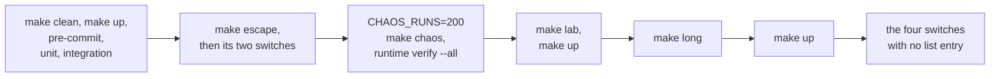
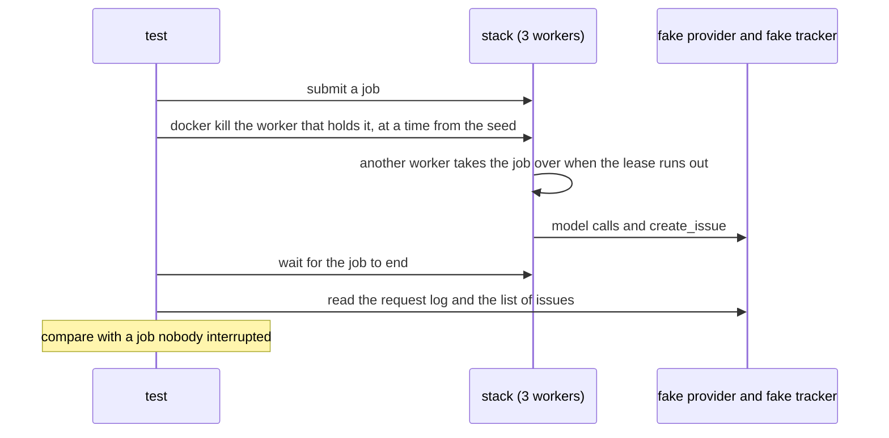

# Results

Each tested guarantee has a test with a pass line fixed before the run, and
a run with the mechanism switched off to show that the test can fail.

The table with one line per guarantee is in the
[README](../../README.md#results). The evidence is on six pages:

- [Durability](durability.md): lost workers, unsafe calls, the step log.
- [Scope and sandbox](sandbox.md): what a tool can reach.
- [Budget, approval, backoff, tool output, the repeat stop](controls.md): what a job may do.
- [Switched-off runs](switched-off.md): each mechanism removed, and the result.
- [A parked job tells the operator](notify.md): the question to `NOTIFY_URL`.
- [A job longer than its context window](long-job.md): summaries and takeovers.

Jobs on a real model, not the evidence for a guarantee: [Runs against the Claude API](api.md),
[Kill run results](kill-runs.md) and [One long job on a real model](long-job-real-model.md).

## The run

The results in the README's table are from one run of the suites below at
one commit, on one machine with no other test run, in this order:

| | |
|---|---|
| Commit | `3b38cdf`, 2026-11-28, 11:40 to 13:15 UTC. The clock was steady for 120 s before the start. |
| Runs and seed | 200 random kill times for the lost-worker test and 200 for the approval test, seed `20261113`; seed `293` for the long suite's kills. Every other test: 1 run. |
| Workers | 3 in the chaos stack, 2 in the lab and the long stack, 1 in the normal stack |
| Provider | The fake provider. The issue tracker is a fake, except Gitea in the lab. |
| Where | Docker Compose on one machine: Linux aarch64 under WSL2, 8 CPUs, Docker 29.1.3, read after the run |

| Chaos tests | Lease | Scenario |
|---|---|---|
| Random kills, a gated job nobody answers, a kill during a sandboxed call | 2 s, renewed every 0.5 s | `ci-triage-slow`: each answer 0.5 s late. `sandbox-kill`. |
| Failpoints, crash loop | 6 s, renewed every 2 s | `ci-triage-slow`, `crash-loop` |
| Pause, stop | The default 30 s, renewed every 10 s | `ci-triage-stall`: two answers 10 s late |

## The suites

| Suite | Command | Result |
|---|---|---|
| Lint, format, types, docs limits | `uv run --frozen pre-commit run --all-files` | Passed |
| Unit | `make test` | 2680 passed |
| Integration | `make integration` | 805 passed |
| Escape | `make escape` | 23 passed |
| Chaos | `CHAOS_RUNS=200 make chaos` | 19 passed in 36 min |
| Step log | `uv run runtime verify --all`, after the chaos run | 484 jobs, 0 mismatches |
| Lab | `make lab` | 5 passed |
| Long job | `make long` | 8 passed in 30 min ([detail](long-job.md)) |

## Runs with a mechanism switched off

Each switch is a change to the source, made for one run and then restored.
At `3b38cdf`, all 54 fake-provider entries of `scripts/switched_off.py` ended
as listed, 171 of 171 tests ([run](https://github.com/sindredg/agent-runtime/actions/runs/46140675351)), on GitHub from 11:36 to 11:51 UTC.
The four switches with no entry ([issue 163](https://github.com/sindredg/agent-runtime/issues/163)) failed their tests last, locally.

The outcomes on the guarantee pages are from 30 switches at `1f57ee4`, unless
a line names another commit. Their output is kept on the machine that ran
them, not in the repository.

Each switch was built into the stack its tests use, so its worker ran the
changed code. The two chaos switches with a random-kill test ran 20 kills. A
property test seldom reaches the cut of a tool result
([issue 61](https://github.com/sindredg/agent-runtime/issues/61)); a sandbox test covers it.

Runs at other commits:

| Commit | What ran | Page |
|---|---|---|
| `185c89b`, `81750b6` | Two switches, on branch commits before that run | [Sandbox](sandbox.md), [Controls](controls.md) |
| `49b9c6e` | Intent write off, fake provider and Claude API | [Kill runs](kill-runs.md#with-the-intent-write-switched-off) |
| `11b6792` | Seven switched-off runs | [Durability](durability.md), [Controls](controls.md) |
| `5a5bfa6` | Stored signature changed, Claude API: 5 of 5 jobs refused | [Kill runs](kill-runs.md#with-the-stored-signature-changed) |
| `30108d4` | The notification's 5 s timing run | [Notification](notify.md#the-first-delivery-comes-within-5-s) |

## How a kill run works

What happened outside a job is read from records other than the job's step
log. See [Testing](../testing.md#records-a-test-trusts).

## What these results do not show

- One run at one commit. Later commits get CI, which runs 20 kills, not 200.
- Nothing in this run reached a real model provider. The one real issue
  tracker is Gitea in a container, in the lab. API runs have their own pages:
  [contract test](../contract-test.md), [eight jobs](api.md), [kill runs](kill-runs.md).
- The chaos run's worker logs, 8,775 lines, hold no error-level line. The
  cause of earlier runs' lease renewal timeouts is not established
  ([issue 69](https://github.com/sindredg/agent-runtime/issues/69)).
- Everything ran on one host with one clock. A lost network between a worker
  and the database is covered by an integration test that cuts the database
  sessions, not by a chaos run.
- The limits the design accepts are in [Known limits](../limits.md).

## Runs that do not count

- `3b38cdf`, first start: the clock check found a 100 ms step, and the run
  stopped before any test. The run above is the second start.
- `e993b32`: every suite passed, but 39 of the 40 switched-off entries ended
  as listed. `refusal-triggers-off` named a test id that no longer existed and
  ran no test ([issue 216](https://github.com/sindredg/agent-runtime/issues/216)).
- `8c22e4e`: a takeover waited up to 39 ms less than its bound, in integration
  and in the sandbox-kill test
  ([issue 49](https://github.com/sindredg/agent-runtime/issues/49)). The
  approval kill test was void: the wall clock moved back 1.2 s.
- `97e56d3`: a unit test that relied on a 0.2 s window failed under load from
  another process ([issue 57](https://github.com/sindredg/agent-runtime/issues/57)).
  The run was stopped.
- `a97318a`: the crash-loop test counted a lost lease as a crash
  ([issue 59](https://github.com/sindredg/agent-runtime/issues/59)). Another
  process loaded the machine during integration.
- `e656fd8`, twice: stopped from outside before the end, once when the shell
  that started it ended, once for load from another process. No test had
  failed.
- One run of the pause test had two takeovers instead of one. The wall clock
  moved forward by 36.6 s, which ended the second worker's lease early.
- One short run at `665bf6a` was aborted: the machine was suspended for about
  eight hours in the middle of it.
- The first trial of the kill test failed 6 of 6. It compared each job with a
  reference job of another scenario. The test was corrected.

The chaos tests compare the wall clock with the monotonic clock, and fail a
test during which they drift apart by more than a second. A clock that is
set forward is a [known limit](../limits.md#durability).
