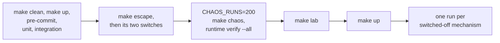
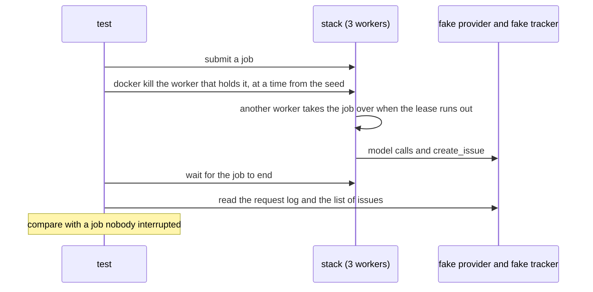

# Results

Each guarantee has a test with a pass line that was fixed before the run, and
a run with the mechanism switched off to show that the test can fail.

The table with one line per guarantee is in the
[README](../../README.md#results). The evidence is on four pages:

- [Durability](durability.md): surviving a lost worker, unsafe tool
  calls, stale workers, crash loops, the step log.
- [Scope and sandbox](sandbox.md): what a tool can reach.
- [Budget, approval, backoff and tool output](controls.md): what a job may
  spend and do.
- [Switched-off runs from the list](switched-off.md): each mechanism
  removed, and how its tests ended.

Jobs that ran with a real model, which are not the evidence for a guarantee:
[Runs against the Claude API](api.md) and [Kill run results](kill-runs.md).

This page has what the runs share: the run, how a kill run works, and what
the results do not show.

## The run

Every result is from one run of every suite at one commit, on one machine
with no other test run, in this order:

| | |
|---|---|
| Commit | `1f57ee4`, 2026-11-18, 21:38 to 23:17 UTC. The clock was steady for 120 s before the start. |
| Runs and seed | 200 random kill times for the lost-worker test, 200 for the approval test, seed `20261113`. Every other test: 1 run. |
| Workers | 3 in the chaos stack, 2 in the lab, 1 in the normal stack |
| Provider | The fake provider. The issue tracker is a fake, except Gitea in the lab. |
| Where | Docker Compose on one machine: Linux aarch64 under WSL2, 8 CPUs, Docker 29.1.3 |

| Chaos tests | Lease | Scenario |
|---|---|---|
| Random kills, a gated job nobody answers, a kill during a sandboxed call | 2 s, renewed every 0.5 s | `ci-triage-slow`: each answer 0.5 s late. `sandbox-kill`. |
| Failpoints, crash loop | 6 s, renewed every 2 s | `ci-triage-slow`, `crash-loop` |
| Pause, stop | The default 30 s, renewed every 10 s | `ci-triage-stall`: two answers 10 s late |

## The suites

| Suite | Command | Result |
|---|---|---|
| Lint, format, types, docs limits | `uv run --frozen pre-commit run --all-files` | Passed |
| Unit | `make test` | 1012 passed |
| Integration | `make integration` | 536 passed |
| Escape | `make escape` | 23 passed |
| Chaos | `CHAOS_RUNS=200 make chaos` | 16 passed in 35 min |
| Step log | `uv run runtime verify --all`, after the chaos run | 421 jobs, 0 mismatches |
| Lab | `make lab` | 2 passed |

## Runs with a mechanism switched off

Each switch is a change to the source, made for one run and then restored.
30 switches, 33 runs, all at `1f57ee4`: each made its tests fail. The outcome
of each is on the guarantee's page. The output is kept on the machine that
ran them, not in the repository.

Each switch was built into the stack its tests use, so the stack's worker
ran the changed code too. The chaos switches used the short run: 20 random kills. A property test
seldom reaches the cut of a tool result
([issue 61](https://github.com/sindredg/agent-runtime/issues/61)); a
sandbox test covers it.

The switches are now entries of `scripts/switched_off.py`, run from the
Manual runs workflow. At `e1656b5`, 2026-11-21, all 34 entries of the fake
provider ran: [96 of 96 tests ended as the list says](switched-off.md). Seven
of them had run before, at `11b6792`. Four switches have no entry yet
([issue 163](https://github.com/sindredg/agent-runtime/issues/163)).

One entry on the Claude API ran at `5a5bfa6`, 2026-11-21: [PASS, 5 of 5 jobs
refused](kill-runs.md#with-the-stored-signature-changed).

## How a kill run works

What happened outside a job is read from records other than the job's step
log. See [Testing](../testing.md#records-a-test-trusts).

## What these results do not show

- Nothing ran against a real model provider. The one real issue tracker is
  Gitea in a container, in the lab. The contract test against the Claude API
  was not part of this run ([The contract test](../contract-test.md)), and
  eight jobs ran against the API separately ([Runs against the Claude API](api.md)).
- The chaos run's worker logs, 10,484 lines, hold no error-level line and
  no failed lease renewal. An earlier run's lease renewals that timed out are
  not explained
  ([issue 69](https://github.com/sindredg/agent-runtime/issues/69)).
- Everything ran on one host with one clock. A lost network between a worker
  and the database is covered by an integration test that cuts the database
  sessions, not by a chaos run.
- The limits the design accepts are in [Known limits](../limits.md).

## Runs that do not count

- `8c22e4e`: a takeover waited up to 39 ms less than its bound, in integration
  and in the sandbox-kill test
  ([issue 49](https://github.com/sindredg/agent-runtime/issues/49)). The
  approval kill test was void: the wall clock moved back 1.2 s.
- `97e56d3`: a unit test that relied on a 0.2 s window failed under load from
  another process ([issue 57](https://github.com/sindredg/agent-runtime/issues/57)).
  The run was stopped.
- `a97318a`: the crash-loop test counted a lost lease as a crash
  ([issue 59](https://github.com/sindredg/agent-runtime/issues/59)). Another
  process loaded the machine during integration.
- `e656fd8`, twice: stopped from outside before the end, once when the shell
  that started it ended, once for load from another process. No test had
  failed.

Earlier runs:

- One run of the pause test had two takeovers instead of one. The wall clock
  moved forward by 36.6 s, which ended the second worker's lease early.
- One short run at `665bf6a` was aborted: the machine was suspended for about
  eight hours in the middle of it.
- The first trial of the kill test failed 6 of 6. It compared each job with a
  reference job of another scenario. The test was corrected.

The chaos tests compare the wall clock with the monotonic clock, and fail a
test during which they drift apart by more than a second. A clock that is
set forward is a [known limit](../limits.md#durability).
