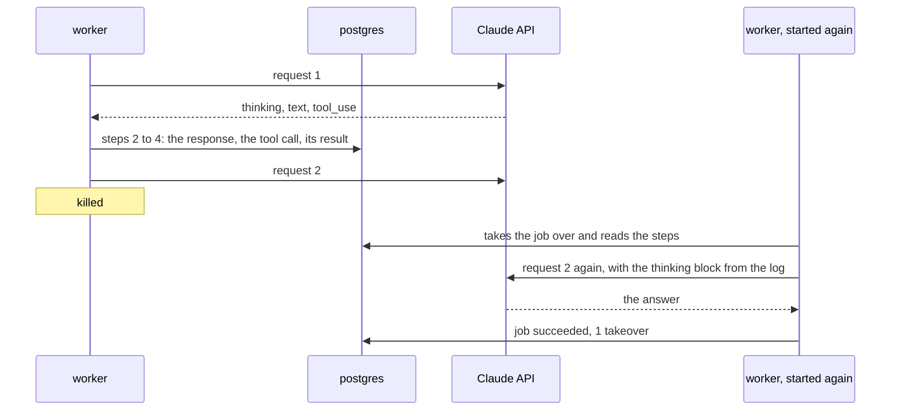

# Runs against the Claude API

Eight jobs ran with the worker on the Claude API instead of the fake
provider. They show that the runtime works with a real model. They are not
the evidence for a guarantee: that is in [Results](README.md).

The last job of the table, drawn:

## The runs

| Job | Pass line | Result |
|---|---|---|
| Read one file (`examples/hello.json`) | Succeeds with one `read_file` call | Succeeded, 1,974 tokens |
| List, read with a shell command, write a note | Succeeds with sandboxed calls | Succeeded, 3,710 tokens. One response held two tool calls. |
| Read a CI log and open an issue | Succeeds with one `create_issue` call | Succeeded. One issue in the fake tracker. |
| Work out an answer, then read the file it names | The API accepts its own `thinking` block back | Succeeded. Response 1 held `thinking`, `text` and `tool_use`. |
| A hard question with a budget of 3,200 tokens | `tokens_used` stays inside the budget | Failed at 2,077 tokens. The budget had lowered `max_tokens` to 10. |
| Read one file with a budget of 1,500 tokens | `tokens_used` stays inside the budget | Refused before the first call, 0 tokens. The input bound was 2,508. |
| The shell job with `run_shell` behind approval | No gated call runs before its answer. A denied call never runs. | Question 5 approved and run, question 11 denied and not run. Succeeded. |
| The fourth job, worker killed in the second model call | Succeeds after one takeover | Succeeded, 1 takeover. The request was sent again. |

## How they ran

| Field | Value |
|---|---|
| Commit | `a27b0f8` |
| Date | 2026-11-17 |
| Model | `claude-haiku-5-5` |
| Stack | `make up`, one worker, the fake issue tracker |
| Runs | each job once, on one machine |

Each pass line was fixed before its run. The first job failed twice before
it passed, at the first model call, on a wrong API key.

## What these runs do not show

- No run with a mechanism switched off. One such run on the API is in
  [Kill runs](../kill-runs.md#with-the-intent-write-switched-off).
- One model, and each job once. A real model does not give the same answer
  twice.
- No refusal by the model and no rate limit was met.
- The kill was at one point, in a model call. Kills at random times and at
  two failpoints ran on the API later: [Kill runs](../kill-runs.md#runs).
- The job files are kept on that machine, not in the repository.
