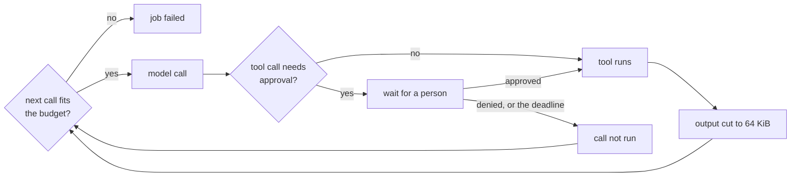

# Results: budget, approval and tool output

The evidence for the guarantees about what a job may spend and do. Every
result here is from the run at `e656fd8`, unless a line names another
commit. Its conditions, and the runs with a mechanism switched off, are on
the [Results](README.md) page. What a job may reach is on
[Scope and sandbox](sandbox.md).

The checks this page has evidence for, around one round of a job:

## Budget, deadline and cancel

Tested. Integration suite, 410 of 410 tests.

- `test_budget.py`: a job that loops, set to read a 2 KB file thirty times,
  with a budget of 20,000 tokens.
- It ends `failed` with "the token budget does not cover the next model
  call", after at least 3 and fewer than 30 calls.
- By the fake provider's own count, it spent at most the budget, and that
  count equals the job's `tokens_used`.
- For each call the provider's input stayed within the recorded bound, and
  the count, the bound and `max_tokens` together fit the budget.

Cancel and deadline, in `test_halt_worker.py`, `test_halt_store.py` and the
halt tests of `test_sandbox.py`:

- A cancel in the middle of a model call, and of a sandboxed command, ends
  the job `cancelled`, with the command's container removed.
- The deadline in the middle of each ends it `failed` with an `error` step.
- Each within 5 s, measured from the request or the deadline to the status
  in the database.
- A claim cancels a job whose cancel was requested and fails one past its
  deadline.
- A job waiting for an approval is failed by the workers' timer within 5 s
  of its deadline.

With the mechanism off:

| Removed | Outcome |
|---|---|
| The check that the next call fits | The call was made with no valid `max_tokens`, and the provider refused it. The job failed with that error, not the budget's. |
| The check and the cut of `max_tokens`, at `bd830cc` | The job spent 282,118 tokens in 31 calls against its 20,000, by the provider's count. The test fails on the spend. |
| The cancel check | Both cancel tests fail. One job ended `succeeded` instead of `cancelled`. |
| The deadline timer | Both deadline tests fail |
| The claim's deadline check | Both claim tests fail. The job stayed `running`. |

## Approval before a tool call

Tested. `tests/chaos/test_approval.py`, 200 runs in the chaos run.

- 200 jobs that ask before `create_issue`. The worker holding the job was
  killed at a random time before the question, and again after the answer.
- 246 kills sent, 122 takeovers. 134 jobs were approved and 66 denied. No
  run failed.
- The tracker holds 134 issues for 134 approvals, each created after its
  approval by the tracker's own time, and none for a denied call.
- Worker stopped after the intent of an approved call: a person is asked
  again. Two approvals, one issue.
- Worker stopped after the approved call ran: the check finds the issue. One
  approval, one issue.
- A job nobody answered, with an 8 s timeout: `failed` 0.06 s after its
  deadline, no issue.

`tests/integration/test_approval.py` covers the same with a tool that
records its own runs. It also checks that a spec cannot take a tool out, and
that an answer counts only for the question it names.

With the mechanism off: with the gate removed, all 4 chaos tests fail. In 20
short runs the tracker holds 20 issues for 0 approvals. 14 of the 19
integration tests fail.

## Bad tool output

Tested. Integration suite, `test_sandbox.py`.

- One job runs commands that exit non-zero, print 100 MB, and print bytes
  that are not UTF-8. Another runs one past its timeout.
- Each becomes a tool result of at most 64 KiB, the 100 MB one flagged
  `truncated`. Each job succeeds, and the model is sent every result.
- `list_dir`, added at `81750b6`: a listing of 2,000 files and a name that is
  not UTF-8 is cut to 64 KiB and flagged `truncated`. The bad name comes back
  as U+FFFD, and the job succeeds.
- `read_file` and `create_issue` run in the worker and have no general
  timeout.

With the mechanism off:

| Removed | Outcome |
|---|---|
| The cut of the stream | The worker kept all 100 MB, and the runner's test fails. The job's test passes: the result is still cut. |
| The cut of the result | The stored result was 65,612 bytes. The job's test fails. |
| The tool timeout | Both timeout tests fail. The command was not stopped. |
| Both cuts, for the `list_dir` test, at `81750b6` | The test fails: the whole listing went to the model, the next call's bound passed the budget, and the job failed. |
