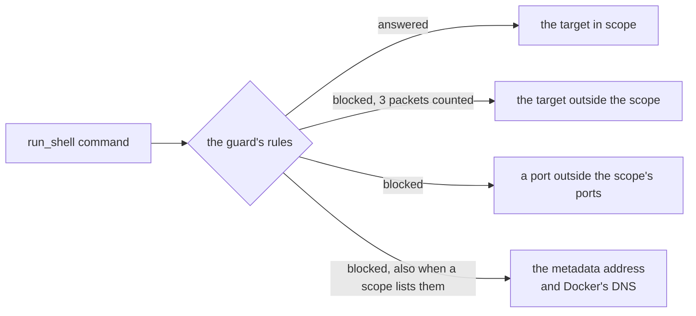

# Results: budget, scope and approval

The evidence for the guarantees about what a job may spend, reach and do.
Every result here is from the run at `e656fd8`, except "Scope and sandbox".
Its conditions, and the runs with a mechanism switched off, are on the
[Results](README.md) page.

## Budget, deadline and cancel

Tested. Integration suite, 410 of 410 tests.

- `test_budget.py`: a job that loops, set to read a 2 KB file thirty times,
  with a budget of 20,000 tokens.
- It ends `failed` with "the token budget does not cover the next model
  call", after at least 3 and fewer than 30 calls.
- By the fake provider's own count, it spent at most the budget, and that
  count equals the job's `tokens_used`.
- For each call the provider's input stayed within the recorded bound, and
  the count, the bound and `max_tokens` together fit the budget.

Cancel and deadline, in `test_halt_worker.py`, `test_halt_store.py` and the
halt tests of `test_sandbox.py`:

- A cancel in the middle of a model call, and of a sandboxed command, ends
  the job `cancelled`, with the command's container removed.
- The deadline in the middle of each ends it `failed` with an `error` step.
- Each within 5 s, measured from the request or the deadline to the status
  in the database.
- A claim cancels a job whose cancel was requested and fails one past its
  deadline.
- A job waiting for an approval is failed by the workers' timer within 5 s
  of its deadline.

With the mechanism off:

| Removed | Outcome |
|---|---|
| The check that the next call fits | The call was made with no valid `max_tokens`, and the provider refused it. The job failed with that error, not the budget's. |
| The check and the cut of `max_tokens`, at `bd830cc` | The job spent 282,118 tokens in 31 calls against its 20,000, by the provider's count. The test fails on the spend. |
| The cancel check | Both cancel tests fail. One job ended `succeeded` instead of `cancelled`. |
| The deadline timer | Both deadline tests fail |
| The claim's deadline check | Both claim tests fail. The job stayed `running`. |

## Scope and sandbox

Tested. `make escape`, 23 of 23 tests, at `5d2f4fd` on 2026-11-17, on the
machine of the `e656fd8` run. This section alone is from that later run: the
suite changed (issues 63 and 64). Docker 29.1.3, `kernel.yama.ptrace_scope`
1, both read from the host and not recorded by the run.

Without a scope, 12 escape attempts, each as a `run_shell` call:

- DNS, TCP out, the cloud metadata address, a network interface besides
  loopback, the Docker socket, a write to the root file system.
- A mount, capabilities, gaining privileges, running as root, 200 forks, 512
  MiB of memory.
- Each was stopped and came back as a failed tool result. 61 of 200 forks
  ran, and the memory hog was killed (137).
- The host's canary file and another job's file were not found, while the
  same search found a file of the job's own. Both stayed unchanged.
- No metadata service runs on this machine. That attempt shows only that the
  address was unreachable.
- Commands ran as uid and gid 10001, the stack's, read with `id` inside the
  container.

With a scope, against two targets on the guards' network:

- The target in scope answered. The one outside was blocked, its packets
  counted (3) and reported to the model.
- A port outside the scope's ports was blocked.
- A pinned name resolved and no other name did.
- The metadata address and Docker's DNS stayed blocked even in a scope that
  listed them, each with its own count.
- `nft flush ruleset` as root in the namespace, without capabilities, was
  refused, and the outside target stayed blocked.

With the mechanism off:

| Switch | Outcome |
|---|---|
| `ESCAPE_DOCKER_DEFAULTS=1`: Docker's default settings, the command as root, and a scoped command on the network directly | 16 of 23 failed: 9 of 12 attempts, the uid test and 6 of 7 scope tests. The control passed. |
| `ESCAPE_NO_RULES=1`: a guard with no rules | All 7 scope tests failed, the other 16 passed |

Which attempts have a failing run:

| Attempt | Got through under the defaults switch |
|---|---|
| DNS, TCP out, a network interface besides loopback | Yes |
| A write to the root file system, capabilities, gaining privileges, running as root | Yes |
| 200 forks, 512 MiB of memory | Yes |
| A mount | No. Docker's default capabilities and seccomp profile refuse it, also to root. |
| The Docker socket, the metadata address, both file searches | No. The switch mounts nothing but the workspace. |

## Approval before a tool call

Tested. `tests/chaos/test_approval.py`, 200 runs in the chaos run.

- 200 jobs that ask before `create_issue`. The worker holding the job was
  killed at a random time before the question, and again after the answer.
- 246 kills sent, 122 takeovers. 134 jobs were approved and 66 denied. No
  run failed.
- The tracker holds 134 issues for 134 approvals, each created after its
  approval by the tracker's own time, and none for a denied call.
- Worker stopped after the intent of an approved call: a person is asked
  again. Two approvals, one issue.
- Worker stopped after the approved call ran: the check finds the issue. One
  approval, one issue.
- A job nobody answered, with an 8 s timeout: `failed` 0.06 s after its
  deadline, no issue.

`tests/integration/test_approval.py` covers the same with a tool that
records its own runs. It also checks that a spec cannot take a tool out, and
that an answer counts only for the question it names.

With the mechanism off: with the gate removed, all 4 chaos tests fail. In 20
short runs the tracker holds 20 issues for 0 approvals. 14 of the 19
integration tests fail.

## Bad tool output

Tested for `run_shell`. Integration suite, `test_sandbox.py`. `list_dir`
runs in a container through the same code and has no bad-output test of its
own ([issue 67](https://github.com/sindredg/agent-runtime/issues/67)).

- One job runs commands that exit non-zero, print 100 MB, and print bytes
  that are not UTF-8. Another runs one past its timeout.
- Each becomes a tool result of at most 64 KiB, the 100 MB one flagged
  `truncated`. Each job succeeds, and the model is sent every result.
- `read_file` and `create_issue` run in the worker and have no general
  timeout.

With the mechanism off:

| Removed | Outcome |
|---|---|
| The cut of the stream | The worker kept all 100 MB, and the runner's test fails. The job's test passes: the result is still cut. |
| The cut of the result | The stored result was 65,612 bytes. The job's test fails. |
| The tool timeout | Both timeout tests fail. The command was not stopped. |
