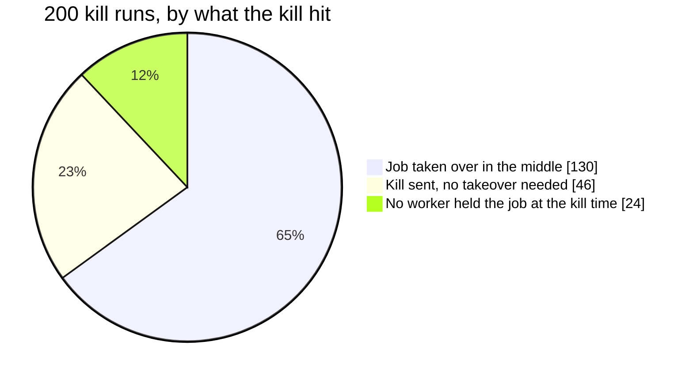

# Results: durability

The evidence for the four durability guarantees, from the chaos run at
`e656fd8`. Its conditions, and the runs with a mechanism switched off, are
on the [Results](README.md) page. The mechanisms are in
[Durability](../durability.md).

## A job survives a worker stopping

Tested. `tests/chaos/test_kills.py`, 200 runs.

- In each run a job was submitted, and the worker holding it was killed with
  `docker kill` at a random time from a seed. 176 kills were sent.
- 200 of 200 jobs succeeded, each with the same final conversation as a job
  nobody interrupted. The provider was never asked an earlier turn again.
- 130 jobs were taken over in the middle, one of them twice: 131 takeovers.
  The second takeover followed a lease renewal that timed out, not a kill
  ([issue 69](https://github.com/sindredg/agent-runtime/issues/69)).
- At 24 kill times no worker held the job, before the claim or after the
  end.
- 46 kills reached the holder and no takeover followed. Their kill times are
  late (1.12 to 1.91 s), so the job most likely ended before the kill.
- One more run per failpoint, with the worker ending its own process: 6 of
  6, each resumed with one takeover and one issue.

With the mechanism off: with resume switched off, so that the log is not
replayed, 10 of 20 short runs failed. The provider was asked turns 0, 1, 2,
0, 1, 2, and the tracker held two issues for one operation id.

## An unsafe tool call does not run twice without approval

Tested, with [one accepted exception](../limits.md#the-main-one-fencing-protects-the-database-not-the-outside-world)
for a worker paused at the wrong instant.

- The same 206 runs: no operation id has more than one issue in the tracker,
  and no approval was needed.
- Worker stopped after the tool ran: the check finds the issue and the
  result is recovered. The tool does not run again.
- Worker stopped after the intent: the check finds nothing and the call runs
  once more. One issue.
- One run with the tracker frozen, so the check gets no answer: the job
  waits in `needs_approval`. After the approval the tracker holds two issues
  for one approval.

With the mechanism off:

| Removed | Outcome |
|---|---|
| The intent write | The two failpoint tests around the tool call fail. Stopped after the tool ran: two issues for one operation id. |
| The tools' own idempotency flags: every tool idempotent | Stopped after the tool ran: two issues for one operation id |

## A stale worker cannot corrupt a job

Tested. `tests/chaos/test_stale_worker.py`.

- A worker waiting for a model answer was paused with `docker pause` for 45
  s under the default 30 s lease.
- Another worker took the job over after 29.3 s.
- The first was woken while the second was in the middle of the job. It
  wrote no step after the takeover, sent no further request to the provider
  and opened no issue.
- The job succeeded with one takeover and one issue.

With the mechanism off: with the epoch check removed from the fence, the
job ended `failed` instead of `succeeded`. The test stopped at that check.
Its checks of what the stale worker wrote have no failing run
([issue 66](https://github.com/sindredg/agent-runtime/issues/66)).

## A job that crashes its worker does not loop forever

Tested. `tests/chaos/test_crash_loop.py`.

- A job whose tool ends the worker's process: `failed` after 5 takeovers,
  with 6 runs in the tool's own log, all of one operation id.

With the mechanism off: with the limit removed, the job was still running
after 180 s and had been taken over 29 times.

## Also tested

- **A graceful stop.** A worker stopped with `docker stop` (SIGTERM) handed
  its job back and ended in 2.9 s. The job finished on another worker with no
  takeover counted.
- **A kill during a sandboxed call.** The next worker removed the killed
  worker's container and asked a person only once the call's bound (37 s)
  had passed. After one approval the command ran again and the job
  succeeded.
