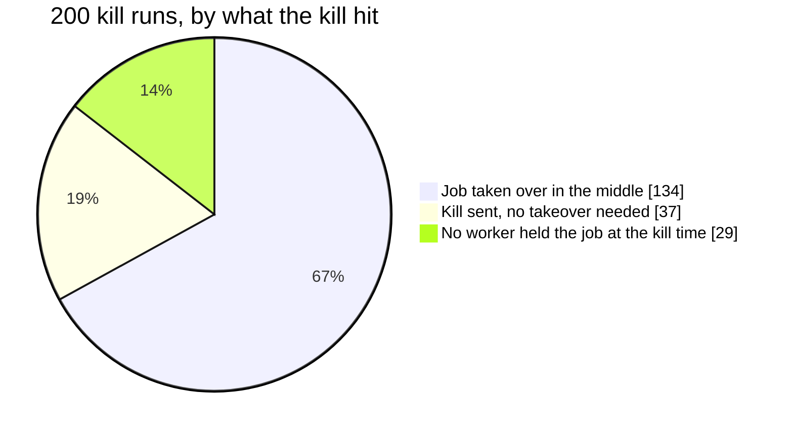

# Results: durability

The evidence for the durability guarantees and the step log, from the run at
`1f57ee4`. Its conditions, and the runs with a mechanism switched off, are
on the [Results](README.md) page. The mechanisms are in
[Durability](../durability.md) and [Hash chain](../step-log-chain.md).

## A job survives a worker stopping

Tested. `tests/chaos/test_kills.py`, 200 runs.

- In each run a job was submitted, and the worker holding it was killed with
  `docker kill` at a random time from a seed. 171 kills were sent.
- 200 of 200 jobs succeeded, each with the same final conversation as a job
  nobody interrupted. The provider was never asked an earlier turn again.
- 134 jobs were taken over in the middle, each once.
- At 29 kill times no worker held the job, before the claim or after the end.
- Every takeover followed a kill at 1.45 s or earlier. The runs with no
  takeover had kill times of 0.04 to 0.10 s or 1.28 s and later.
- One more run per failpoint, with the worker ending its own process: 6 of
  6, each resumed with one takeover and one issue.

With the mechanism off: with resume switched off, so that the log is not
replayed, 13 of 20 short runs failed. The provider was asked turns 0, 1, 0,
1, 2.

The failpoint runs with resume off, at `11b6792` ([run](https://github.com/sindredg/agent-runtime/actions/runs/44808424822)):

| Failpoint | Outcome |
|---|---|
| After the tool's intent | Fails: the provider was asked turns 0, 1, 0, 1, 2 |
| After the tool ran, after its result | Fail: the same, and two issues for one operation id |
| After the claim, after the model request, mid-stream | Pass. The kill comes before any completed step, so starting over is the same as resuming. |

## An unsafe tool call does not run twice without approval

Tested, with accepted exceptions: a
[worker paused at the wrong instant](../limits.md#the-main-one-fencing-protects-the-database-not-the-outside-world),
and the [limits of tool calls](../limits.md#tool-calls).

- The same 206 runs: no operation id has more than one issue in the tracker,
  and no approval was needed.
- Worker stopped after the tool ran: the check finds the issue and the
  result is recovered. The tool does not run again.
- Worker stopped after the intent: the check finds nothing and the call runs
  once more. One issue.
- One run with the tracker frozen, so the check gets no answer: the job
  waits in `needs_approval`. After the approval the tracker holds two issues
  for one approval.

Against a real tracker, Gitea in a container (`make lab`,
[Lab demo](../lab-demo.md)): 2 of 2 cases. In each the worker stopped
itself in the call, another took over, and Gitea held exactly one issue.

With the mechanism off:

| Removed | Outcome |
|---|---|
| The intent write | The two failpoint tests around the tool call fail. Stopped after the tool ran: two issues for one operation id. |
| The tools' own idempotency flags: every tool idempotent | Stopped after the tool ran: two issues for one operation id |
| The Gitea check, forced to "not done" | Stopped after the call ran: two issues in Gitea |
| The marker line in the issue body | Two issues in Gitea in one case, an issue without its marker in the other |
| A check that cannot tell, treated as not done, at `11b6792` ([run](https://github.com/sindredg/agent-runtime/actions/runs/44808435953)) | The job succeeded without waiting for a person. The test fails on `needs_approval`. |

## A stale worker cannot corrupt a job

Tested. `tests/chaos/test_stale_worker.py`.

- A worker waiting for a model answer was paused with `docker pause` for 45
  s under the default 30 s lease.
- Another worker took the job over after 29.8 s.
- The first was woken while the second was in the middle of the job. It
  wrote no step after the takeover, sent no further request to the provider
  and opened no issue. The job succeeded with one issue.

With the mechanism off: with the epoch check removed from the fence, the
woken worker wrote an `error` step with its old epoch after the takeover.

## A job that crashes its worker does not loop forever

Tested. `tests/chaos/test_crash_loop.py`.

- A job whose tool ends the worker's process: `failed` after 5 takeovers,
  with 6 runs in the tool's own log, all of one operation id.

With the mechanism off: with the limit removed, the job was still running
after 180 s and had been taken over 29 times.

## The step log cannot be changed without detection

Tested, with [stated limits](../step-log-chain.md#what-it-does-not-catch). Integration suite:
`test_step_log_chain.py`, `test_verify_command.py`, `test_roles.py`.

- The app role is refused UPDATE, DELETE and TRUNCATE on steps, and
  `DISABLE TRIGGER`, `DROP TABLE` and `session_replication_role`. The owner
  is refused the first three while the triggers are on.
- With the triggers off, the owner changed, deleted, reordered, inserted and
  rehashed steps, moved the head and cut the tail. Verify named each of the
  9 cases. The owner cutting the tail and setting the head back is not found.
- After the chaos run, `runtime verify --all` checked every job in the
  database, 421, the chaos run's among them: 0 mismatches.

With the mechanism off:

| Removed | Outcome |
|---|---|
| The refusal triggers | The owner's UPDATE, DELETE and TRUNCATE went through: 3 tests fail, and the downgrade test |
| The hash comparison in verify | 15 tests fail. The 3 changes in place went unfound, and 4 more cases were flagged only by the order or head check. |

## Also tested

- **A graceful stop.** A worker stopped with `docker stop` (SIGTERM) handed
  its job back and ended in 1.2 s. The job finished on another worker with no
  takeover counted.
- **A kill during a sandboxed call.** The next worker removed the killed
  worker's container and asked a person only once the call's bound (40 s)
  had passed. After one approval the command ran again and the job
  succeeded.

With the mechanism off, at `11b6792`:

| Removed | Outcome |
|---|---|
| The hand-back on a stop ([run](https://github.com/sindredg/agent-runtime/actions/runs/44808467134)) | The job stayed `running`, with no other claim within 10 s. The test fails. |
| The removal and the wait after a takeover ([run](https://github.com/sindredg/agent-runtime/actions/runs/44808477135)) | The killed worker's container was still running after the takeover. The test fails. |
