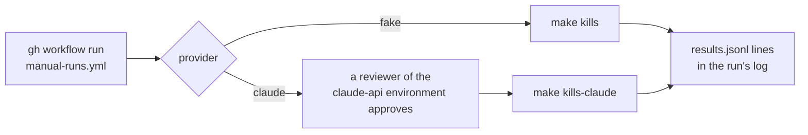

# Results: kill runs

The recorded kill runs, on the fake provider and on the Claude API. How a
run works and what each job is judged by: [Kill runs](../kill-runs.md).

## Runs

One run per row, from the Manual runs workflow on GitHub Actions (Linux
x86_64, 4 CPUs): seed `20261119`, 3 + 20 + 5 + 5 jobs.

| Provider, model | Commit | Window | Kills that hit the holder | Tokens, all jobs | Most in one job | Run |
|---|---|---|---|---|---|---|
| Fake provider | `adc388d` | 1.76 s | 17 of 20 | 65,835 | 1,995 | [44602128214](https://github.com/sindredg/agent-runtime/actions/runs/44602128214) |
| Claude API, `claude-haiku-5-5` | `adc388d` | 3.31 s | 18 of 20 | 131,545 | 4,079 | [44604752837](https://github.com/sindredg/agent-runtime/actions/runs/44604752837) |
| Claude API, `claude-opus-5-5` | `adc388d` | 7.03 s | 19 of 20 | 138,432 | 4,352 | [44606477808](https://github.com/sindredg/agent-runtime/actions/runs/44606477808) |
| Claude API, `claude-fable-5-2` | `adc388d` | 7.98 s | 20 of 20 | 142,234 | 4,582 | [44608054848](https://github.com/sindredg/agent-runtime/actions/runs/44608054848) |
| Fake provider | `88e652a` | 1.67 s | 19 of 20 | 65,835 | 1,995 | [44622555518](https://github.com/sindredg/agent-runtime/actions/runs/44622555518) |
| Claude API, `claude-fable-5-2` | `88e652a` | 7.82 s | 20 of 20 | 142,055 | 4,511 | [44623481715](https://github.com/sindredg/agent-runtime/actions/runs/44623481715) |

In every row: 4 of 4 tests passed, every job whose holder was killed was
taken over, and each failpoint fired in 5 of 5 jobs. No approval was asked
for, no job had more than one `create_issue` operation, and no operation id
has two issues.

Status: tested for the `after_tool_ran` test, which has a switched-off run on
the fake provider and on `claude-haiku-5-5` (below). The other three tests,
and the Opus, Fable and `88e652a` rows, passed with no switched-off run of
their own.

### Thinking blocks sent back after a takeover

The runs at `88e652a` count `thinking` blocks
([Kill runs](../kill-runs.md#recorded-not-judged)). The fake provider
returns none. On `claude-fable-5-2`, which checks a block it gets back:

| Test | Jobs with a block | Sent one back after a takeover |
|---|---|---|
| Jobs nobody interrupts | 3 of 3 | none: no takeover |
| Random kills | 19 of 20 | 7 |
| `after_tool_intent` | 4 of 5 | 4 |
| `after_tool_ran` | 4 of 5 | 4 |

In 15 jobs a worker that never received the block rebuilt it from the step
log, sent it, and the API answered. All 15 succeeded. In the other jobs the
takeover came before the first block, or no answer held one. One run, with
no switched-off run yet: a block changed before it goes back is
[issue 122](https://github.com/sindredg/agent-runtime/issues/122).

### With the intent write switched off

The same commit with the intent write removed, as branch
`must-fail/g2-intent-skipped` (`49b9c6e`, deleted afterwards). Five jobs at
`after_tool_ran`. The run has to end red.

| Provider, model | Result | Run |
|---|---|---|
| Fake provider | Red. 5 of 5 jobs have two issues for one operation id. | [44602234151](https://github.com/sindredg/agent-runtime/actions/runs/44602234151) |
| Claude API, `claude-haiku-5-5` | Red. 5 of 5 jobs have two issues for one operation id. | [44605952449](https://github.com/sindredg/agent-runtime/actions/runs/44605952449) |

## What a pass does not show

- The order of the requests the provider got. On the fake provider the
  chaos tests check it; the Claude API keeps no such log to read.
- That a killed job gives the same answer as one nobody interrupted.
- A rate. Twenty jobs without a failure put the failure rate under about
  14 percent, at 95 percent confidence, and no lower.
- A kill during a model's second call of a tool. The failpoints fire in the
  job's first `create_issue` call.
- A `thinking` block sent back after a takeover on Haiku or Opus. Those
  runs are from before the results counted it.
- More than one run per model, except two on `claude-fable-5-2`. GitHub
  Actions deletes a run's log after 90 days; a copy is kept outside the
  repository.
