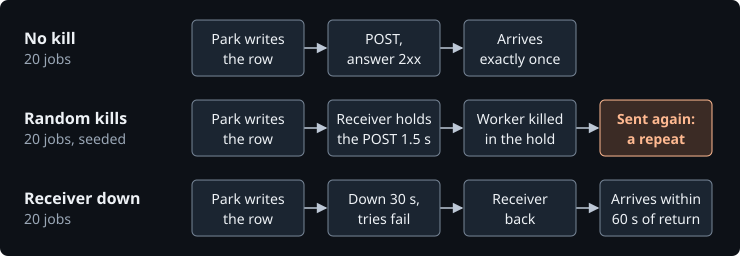

# Results: a parked job tells the operator

The evidence that a job which waits for a person tells the operator: it
posts its question to `NOTIFY_URL`, at least once. How the delivery works is in
[ADR 0029](../adr/0029-notify-from-a-row-the-park-writes.md).

The three chaos tests also ran in the [full run](README.md#the-run) at
`4ed43c0`. The other results are from CI and Manual runs on GitHub, each from
`main`, each named with its commit and run.

## Every question reaches the receiver

Tested. `tests/chaos/test_notify.py`, three tests in the chaos suite, a
required check, run on every pull request that changes more than `docs/`. Each is judged by the fake receiver's
own log of the POSTs it was sent, against each job's `approval_requested`
steps.

| | |
|---|---|
| Runs | The chaos job of CI on `main`: [45032112259](https://github.com/sindredg/agent-runtime/actions/runs/45032112259) at `30108d4`, [45047730136](https://github.com/sindredg/agent-runtime/actions/runs/45047730136) at `7096a5c`, 2026-11-22. 1 run of each test per CI run. |
| Full run | `4ed43c0`, 2026-11-23, 1 run of each test. Linux aarch64, 8 CPUs. |
| Jobs and seed | 20 jobs per test, scenario `ci-triage-slow`, gated on `create_issue`. Kill seed `20261113`. |
| Workers and lease | 3 in the chaos stack, lease 2 s |
| Provider | The fake provider and the fake receiver |
| Where in CI | GitHub-hosted runner, Linux x86_64, 4 CPUs |

Each test's pass line, and its result at each commit:

| Test | Pass line | `30108d4` | `7096a5c` | `4ed43c0` |
|---|---|---|---|---|
| No kill | Each question arrives exactly once | 20 of 20 once | 20 of 20 once | 20 of 20 once |
| Random kills | Each arrives at least once; at least one repeat | 20 of 20; 9 kills, 8 repeats | 20 of 20; 8 kills, 5 repeats | 20 of 20; 7 kills, 7 repeats |
| Receiver down 30 s | No job ends; each arrives within 60 s of the return | 20 of 20, slowest 8.5 s | 20 of 20, slowest 8.0 s | 20 of 20, slowest 7.9 s |

The no-kill test holds every job parked 16 s after the last first arrival,
past the 12 s a claim pushes a row ahead. A second POST of any question in
that time fails the test.

In the kill test the receiver holds each POST 1.5 s before it answers.
Without the hold a kill almost never lands between the claim and the
record, and no repeat shows. A run with no repeat is not a pass: it does
not show a POST that is lost and sent again.

## The first delivery comes within 5 s

Tested. `tests/notify_timing/test_notify_timing.py`, Manual runs workflow,
suite `notify-timing`.

| | |
|---|---|
| Run | [45032327091](https://github.com/sindredg/agent-runtime/actions/runs/45032327091) at `30108d4`, 2026-11-22, from `main`. 1 run. |
| Jobs | 50 questions, receiver up, no kill |
| Stack | `make up`: 1 worker, the fake provider |
| Where | GitHub-hosted runner, Linux x86_64, 4 CPUs. One clock for the database and the receiver. |
| Result | 50 of 50 arrived within 5 s of the park step. Median 0.66 s, slowest 0.995 s. |

## With the mechanism off

Two entries of the [switched-off list](switched-off.md), each run once from
`main` at `30108d4` on the chaos stack. Each ended 3 of 3 tests on
`assert missing == []`: no question arrived. Both ended as listed again in
the [run at `4ed43c0`](https://github.com/sindredg/agent-runtime/actions/runs/45204873674).

| Entry | Removed | Run |
|---|---|---|
| `notify-loop-off` | The loop in every worker that posts a parked job's question | [45032321971](https://github.com/sindredg/agent-runtime/actions/runs/45032321971) |
| `notify-row-off` | The notification row the park writes with the job's move | [45032324614](https://github.com/sindredg/agent-runtime/actions/runs/45032324614) |

The no-kill test also fails when a delivered row is not closed. That run
was local, during the build, and is not recorded here.

## What these results do not show

- One run of each test per commit, 20 jobs, one kill seed. Three commits
  passed; more runs take other paths.
- The receiver-down test never reaches the longer retry delays. In a local
  measurement each row failed once or twice in the 30 s
  ([issue 194](https://github.com/sindredg/agent-runtime/issues/194)).
- The receiver is a fake on the same host. A real receiver over a network,
  with TLS, was not tested.
- The accepted limits of a notification are in
  [Known limits](../limits.md#approval).
