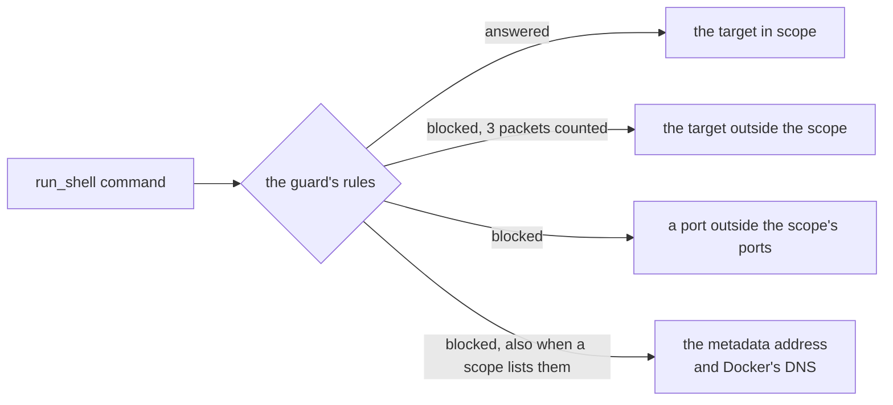

# Results: scope and sandbox

The evidence that a tool reaches only its job's scope, and nothing else of
the host. The conditions of the runs are on the [Results](README.md) page.
The mechanisms are in [Sandbox](../sandbox.md) and [Scope](../scope.md).

Tested. `make escape`, 23 of 23 tests, in the run at `4ed43c0`, unless a
line names another commit. Docker 29.1.3, `kernel.yama.ptrace_scope` 1,
both read from the host and not recorded by the run.

Without a scope, 12 escape attempts, each as a `run_shell` call:

- DNS, TCP out, the cloud metadata address, a network interface besides
  loopback, the Docker socket, a write to the root file system.
- A mount, capabilities, gaining privileges, running as root, 200 forks, 512
  MiB of memory.
- Each was stopped and came back as a failed tool result. 61 of 200 forks
  ran, and the memory hog was killed (137).
- The host's canary file and another job's file were not found, while the
  same search found a file of the job's own. Both stayed unchanged.
- No metadata service runs on this machine. That attempt shows only that the
  address was unreachable.
- Commands ran as uid and gid 10001, the stack's, read with `id` inside the
  container.

With a scope, against two targets on the guards' network:

- The target in scope answered. The one outside was blocked, its packets
  counted (3) and reported to the model.
- A port outside the scope's ports was blocked.
- A pinned name resolved and no other name did.
- The metadata address and Docker's DNS stayed blocked even in a scope that
  listed them, each with its own count.
- `nft flush ruleset` as root in the namespace, without capabilities, was
  refused, and the outside target stayed blocked.
- In the stack: the worker refused a job whose scope named
  `postgres:5432` before any call, and the job went on
  (`tests/integration/test_scope_in_stack.py`).

With the mechanism off:

| Switch | Outcome |
|---|---|
| `ESCAPE_DOCKER_DEFAULTS=1`: Docker's default settings, the command as root, and a scoped command on the network directly | 16 of 23 failed: 9 of 12 attempts, the uid test and 6 of 7 scope tests. The control passed. |
| The runtime's networks left out of the worker's deny list, at `185c89b` | The scoped command connected to Postgres. Docker's network isolation did not stop it: the deny list is the only barrier. |
| `ESCAPE_NO_RULES=1`: a guard with no rules | All 7 scope tests failed, the other 16 passed |

Which attempts have a failing run:

| Attempt | Got through under the defaults switch |
|---|---|
| DNS, TCP out, a network interface besides loopback | Yes |
| A write to the root file system, capabilities, gaining privileges, running as root | Yes |
| 200 forks, 512 MiB of memory | Yes |
| A mount | No. Docker's default capabilities and seccomp profile refuse it, also to root. |
| The Docker socket, both file searches | No. The switch mounts nothing but the workspace. |
| The metadata address | No. The network was open, and nothing on this machine answered. |

## Workspace size

Tested, as a soft limit ([Sandbox](../sandbox.md#workspace-size)).
Integration suite, `test_sandbox.py`:

- With an 8 MiB limit and a 0.2 s interval, a command that writes on was
  stopped within 5 s with a failed result that names the limit. The
  workspace held between 8 and 16 MiB, and the container was gone.
- With a 1 MiB limit, a workspace already over it ran no command.

With the mechanism off, at `1f57ee4`, each of 10 switches failed its tests.
Among them:
no measurement during a call, none before it, no cap on files, no deadline
on the walk, and a watcher that leaves the run going on a cancel (a
container was left).
