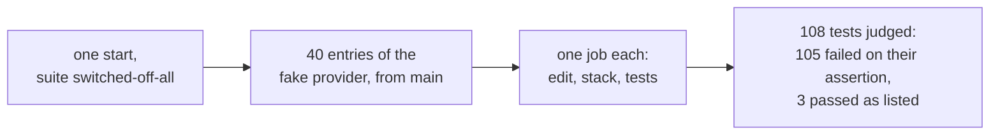

# Results: switched-off runs from the list

Each entry of `scripts/switched_off.py` removes one mechanism, runs the tests
that guard it, and names the assertion each test must fail on
([ADR 0021](../adr/0021-run-switched-off-runs-from-a-reviewed-list.md)).
A test that ends any other way is red.

The list can also say that a test passes, with the reason. Three tests of
`resume-off` kill the worker before any step is complete, so starting over
is the same as resuming.

Status: tested. The 40 entries of the run below ran from `main` at
`4ed43c0`. Three entries ran again at `96172b5`, after the provider-error
change ([below](#run-at-96172b5)). `repeat-stop-off` ran at `377304c`
([below](#run-at-377304c)).

| | |
|---|---|
| Run | [45204873674](https://github.com/sindredg/agent-runtime/actions/runs/45204873674), 2026-11-23 |
| Commit | `4ed43c0` |
| Entries | 40 of 40 ended as the list says. 1 run each. |
| Tests | 108 of 108 ended as the list says: 105 failed on their named assertion, 3 passed as listed. |
| Provider | The fake provider. No job of the run holds a secret. |
| Where | GitHub-hosted `ubuntu-26.04` runners, one job per entry. The logs are public and kept 90 days. |

## The entries

| Entry | Mechanism switched off | Stack | Tests |
|---|---|---|---|
| `budget-off` | The check that the next call fits and the cut of max_tokens | Normal | 1 |
| `resume-off` | The replay of the step log on a claim | Chaos | 6 |
| `unknown-check-reruns` | Asking a person when a check cannot tell (ADR 0005) | Chaos | 1 |
| `claim-cancel-off` | The claim's cancel of a job whose cancel was requested | Normal | 1 |
| `overdue-timer-off` | The workers' timer that fails jobs waiting past their deadline | Normal | 1 |
| `stop-release-off` | The hand-back of a job when its worker is told to stop | Chaos | 1 |
| `takeover-outlast-off` | The removal of an earlier lease's container, and the wait, after a takeover | Chaos | 1 |
| `resume-off-random-kills` | The replay of the step log on a claim, with workers killed at random times | Chaos | 1 |
| `intent-write-off-chaos` | The step that records a tool call's intent before it runs | Chaos | 2 |
| `every-tool-idempotent` | The tools' own idempotency flags: every tool is treated as idempotent | Chaos | 1 |
| `epoch-check-off` | The lease epoch in the fence of a worker's writes | Chaos | 1 |
| `gitea-check-not-done` | The Gitea check of create_issue, which always says not done | Lab | 1 |
| `issue-marker-off` | The marker line with the operation id in the issue body | Lab | 2 |
| `refusal-triggers-off` | The triggers that refuse a change to the step log | Normal | 3 |
| `chain-check-off` | The comparison of each step's hash in verify | Normal | 15 |
| `budget-check-off` | The check that the next call fits the budget; the cut of max_tokens stays | Normal | 1 |
| `claim-deadline-off` | The claim's check of a job's deadline | Normal | 2 |
| `approval-gate-off` | The gate that asks a person before a tool call that needs approval | Normal | 14 |
| `approval-gate-off-chaos` | The gate that asks a person before a tool call, with workers killed | Chaos | 4 |
| `busy-answer-fails` | The wait on a busy answer: a 429 or 529 fails the job | Normal | 5 |
| `retry-after-ignored` | The floor that the provider's retry-after sets on a wait | None | 4 |
| `claim-ignores-not-before` | The claim's wait for a waiting job's not_before | Normal | 5 |
| `stream-cut-off` | The cut of a command's output stream at the limit | Normal | 1 |
| `result-cut-off` | The cut of a tool result to its limit | Normal | 1 |
| `tool-timeout-off` | The timeout of a sandboxed command, in the runner and in the container | Normal | 2 |
| `halt-leaves-the-call-running` | The cancel of a running sandboxed command when its call ends early, as on a halt | Normal | 3 |
| `workspace-watcher-off` | The measurement of the workspace while a command runs | Normal | 3 |
| `workspace-precheck-off` | The measurement of the workspace before a command starts | None | 4 |
| `workspace-entry-cap-off` | The cap on the files and directories one walk counts | None | 2 |
| `workspace-walk-deadline-off` | The deadline of one walk of the workspace | None | 2 |
| `workspace-run-bound-off` | The part of a call's bound kept for the measurement | None | 1 |
| `workspace-timeout-off` | The time box of one measurement of the workspace | None | 1 |
| `workspace-stop-signal-off` | The signal that tells a walk to stop past its time box or on a cancel | None | 2 |
| `workspace-walk-stop-off` | A walk's check of the signal to stop | None | 1 |
| `takeover-wait-for-a-request-off` | The bound `create_issue` names for its request, which a takeover waits out | Normal | 2 |
| `create-deadline-off` | The one deadline of the request that opens an issue | None | 2 |
| `abortive-close-off` | The reset of a given-up request's connection | None | 1 |
| `notify-loop-off` | The loop in every worker that posts a parked job's question | Chaos | 3 |
| `notify-row-off` | The notification row the park writes with the job's move | Chaos | 3 |
| `tool-env-passed-on` | The tool container's environment, which holds nothing of the worker's | Normal | 1 |

### Run at `96172b5`

One run each, from `main`, on the fake provider, on GitHub-hosted
`ubuntu-26.04` runners. Every test ended as the list says.

| Entry | Mechanism switched off | Stack | Tests | Run |
|---|---|---|---|---|
| `provider-error-fails` | The wait on a provider error that may pass: it fails the job | Normal | 21 of 21 | [45296388449](https://github.com/sindredg/agent-runtime/actions/runs/45296388449) |
| `provider-error-cap-off` | The caps on waits for a provider error, in a row and in the job | Normal | 6 of 6 | [45296393483](https://github.com/sindredg/agent-runtime/actions/runs/45296393483) |
| `busy-answer-fails` | The wait on a 429 or 529. Its edit now fails the job itself | Normal | 5 of 5 | [45296384558](https://github.com/sindredg/agent-runtime/actions/runs/45296384558) |

### Run at `377304c`

One run, from `main`, on the fake provider, on a GitHub-hosted `ubuntu-26.04`
runner. Every test ended as the list says.

| Entry | Mechanism switched off | Stack | Tests | Run |
|---|---|---|---|---|
| `repeat-stop-off` | The stop of a job that repeats one call with the same result (ADR 0031) | Normal | 2 of 2 | [45343453661](https://github.com/sindredg/agent-runtime/actions/runs/45343453661) |

### The long job

Runs from `main` on the fake provider, each on a GitHub-hosted
`ubuntu-26.04` runner, 2026-11-27. Every test ended as the list says.

| Entry | Mechanism switched off | Commit | Tests | Run |
|---|---|---|---|---|
| `long-trigger-off` | The summary trigger | `20a2582` | 1 of 1 | [46065717220](https://github.com/sindredg/agent-runtime/actions/runs/46065717220) |
| `long-replay-skips-summary` | Summary steps in a replayed log | `20a2582` | 3 of 3, one passes as listed | [46065720346](https://github.com/sindredg/agent-runtime/actions/runs/46065720346) |
| `long-summary-cut` | Half of the summary in a window's opening message | `20a2582` | 1 of 1 | [46065723399](https://github.com/sindredg/agent-runtime/actions/runs/46065723399) |
| `long-own-trigger` | The trigger the first request pinned | `7395f47` | 1 of 1 | [46069200626](https://github.com/sindredg/agent-runtime/actions/runs/46069200626) |
| `long-oversize-off` | The stop of a window that opens at the trigger | `20a2582` | 1 of 1 | [46065729503](https://github.com/sindredg/agent-runtime/actions/runs/46065729503) |

The first run of `long-own-trigger`, at `20a2582`, did not count. The test
stopped before the takeover: a killed worker was still listed as running
([issue 255](https://github.com/sindredg/agent-runtime/issues/255)). The
harness now waits up to 10 s for killed workers to stop. The run at `7395f47`
failed on the named assertion.

### Earlier outcomes

Two outcomes read at earlier commits. With the bound off, at `fbb293f`, two
workers and a stalled tracker ended with two issues for one call. With the
environment passed on, at `7096a5c`, the secret test found the provider key
and the tracker token in a tool result and in two answers of the API.

The one entry on the Claude API, `thinking-signature-changed`, did not run
here. It has [its own run](kill-runs.md#with-the-stored-signature-changed) at `5a5bfa6`.

## What this run does not show

- One run per entry. The entries on the chaos stack kill workers at random
  times, so a second run takes other paths.
- Four switches have no entry: the takeover cap, the cancel check, the
  deadline timer, and the skip in the workspace walk. Each failed its tests
  at `4ed43c0`, on the full run's machine. Their tests end in a timeout or an
  error, not on an assertion
  ([issue 163](https://github.com/sindredg/agent-runtime/issues/163)).
- Two more have no entry: the deny list without the runtime's networks
  ([sandbox](sandbox.md)) and both cuts for `list_dir`
  ([controls](controls.md#bad-tool-output)).
- An entry shows that its tests can fail. It does not show that they catch
  every way the mechanism can break.
