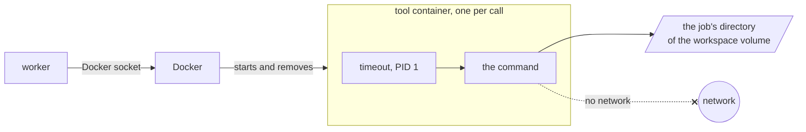
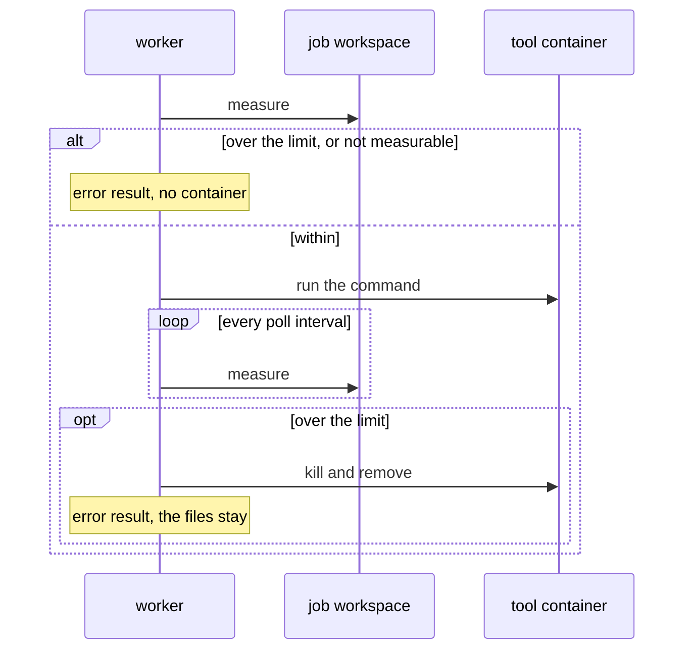
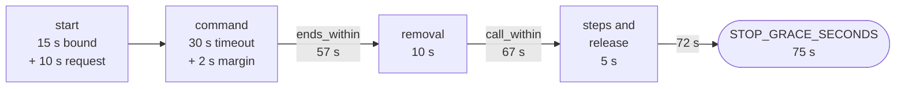

# Sandbox

Each `run_shell` or `list_dir` call runs in a container of its own, started
by the worker ([ADR 0008](adr/0008-run-each-tool-call-in-its-own-container.md)).
The code is `src/runtime/sandbox/runner.py`.

## One container per call

The container is built from fixed settings. The model's input becomes only
the command's arguments, never an image, a mount or a flag.

| Setting | Value |
|---|---|
| Network | None. A `run_shell` call of a job with a [scope](scope.md) gets its targets. |
| Root file system | Read-only, with an in-memory `/tmp` of 16 MiB |
| Capabilities | All dropped, and `no-new-privileges` |
| User | uid 10001, not root |
| CPU, memory, processes | 1 CPU, 256 MiB with no swap, 64 processes |
| Mount | Only the job's directory of the workspace volume, by `volume-subpath` |
| Workspace size | 1 GiB, soft: see [below](#workspace-size) |
| Labels | The job id and the lease epoch |
| Log driver | None |

`run_shell` and `list_dir` are offered only when `SANDBOX_IMAGE` is set, as
it is in the stack. `read_file` and `create_issue` run in the worker process.

## Workspace size

The job's workspace is on the disk that holds Postgres too. The worker
measures it and stops a command that makes it too big
([ADR 0014](adr/0014-limit-a-jobs-workspace-with-a-watcher.md)).

- The size is the blocks the files and directories take, measured from the
  worker's mount (`src/runtime/sandbox/workspace.py`). Links are not
  followed. A sparse file counts what it uses.
- A directory the worker cannot read, or nesting too deep to walk, counts as
  over the limit. The command runs as the worker's uid and could hide files
  with `chmod`.
- The limit is soft. A command writes on for up to one interval, plus the
  time a measurement and the kill take. The test writes about 20 MiB/s
  with an 8 MiB limit and a 0.2 s interval, and allows up to 16 MiB.
- A job over its limit cannot shrink: `run_shell` does not start. It goes on
  without sandboxed tools. The number of files is not limited.

## Time bounds

| Bound | With the defaults | Means |
|---|---|---|
| `SANDBOX_TIMEOUT_SECONDS` | 30 s | The command's time, from the start request to the exit status. Then the container is killed. |
| Start bound | 15 s | Docker is not asked to start the command later than this after the call began |
| Start request | 10 s | One Docker request's timeout |
| `ends_within` | 57 s | By then the container has ended, also when its worker is gone. Two cases are [not covered](limits.md#tool-calls). |
| `call_within` | 67 s | By then the whole call has returned, removal included |
| Stop margin | 5 s | For the steps before and after the call, and for handing the job back |

- The command also runs under `timeout` inside the container, at the timeout
  plus 2 s. A container whose worker is gone ends by itself.
- The worker refuses to start unless `call_within` plus the stop margin fits
  in `STOP_GRACE_SECONDS`.
- A call that Docker holds up past its bound fails: as a command that did not
  run if the start was never asked for, otherwise as one that may have run.
- If only what follows the command was held up, the command's result is kept.

## Why the command cannot stop its own timeout

- `timeout` is the container's PID 1, with no other init. The kernel does not
  let a process stop or kill the init of its namespace.
- When `timeout` exits, every process left in the container ends.
- ptrace could stop it too. A worker with the sandbox refuses to start on a
  host where `kernel.yama.ptrace_scope` is 0 or Yama is missing.
- Nothing reaps orphaned processes during a call. They count toward the 64.

## The result

The worker reads stdout and stderr from the attach stream as one stream and
keeps the first 64 KiB. The result is, in this order:

1. The output. Invalid UTF-8 and NUL bytes become U+FFFD.
2. A note if the output was cut.
3. The exit status or the timeout.
4. For a scoped call, the number of packets its guard dropped, if any.

The whole text is at most 64 KiB.

| What happened | The result |
|---|---|
| Exit status 0 | The output |
| A non-zero exit or a timeout | An error result. The job goes on. |
| A Docker failure before the start | An error result that says the command did not run |
| A Docker failure after the start | An error result that says the command may have run |

## Removal

- The worker names the container itself, and removes it by name after every
  call.
- That also holds when the call was cancelled: the removal runs in a task
  that a second cancel does not stop.
- A removal that is not done by the call's bound goes on without the call.
- A worker that takes over a job with an interrupted sandboxed call removes
  the containers that earlier leases of the job left on its host. See
  [Interrupted tool calls](interrupted-calls.md).

What a removal can leave behind is in [Known limits](limits.md#sandbox-and-scope).
