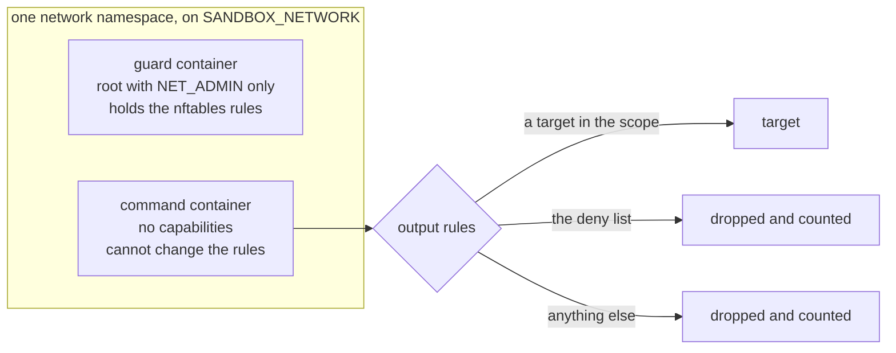
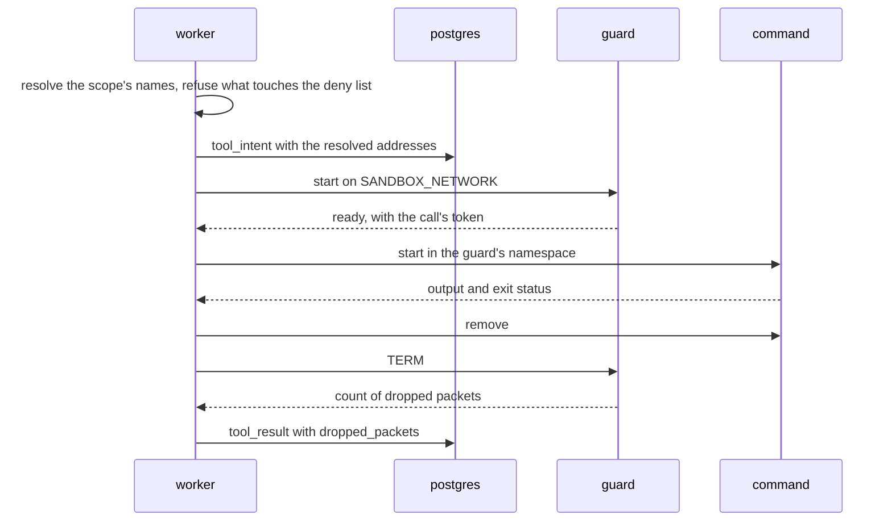

# Scope

A job's `scope` lists the targets its `run_shell` calls may reach on the
network. Everything else is dropped by a firewall the command cannot change
([ADR 0009](adr/0009-enforce-the-target-scope-in-the-network-namespace.md)).
A job without a scope gets no network. `list_dir` never gets one.

## Two containers, one network namespace

The guard starts first and loads the rules. The command's container then
joins the guard's namespace. The command never runs in the guard.

## A scoped call

- A refused call gets an error result and no intent.
- The worker waits for the guard's `ready` within the start bound.
- If the command's container could not be removed, no count is stored.
- Names are pinned in the guard's hosts file, which the command shares.
  Nothing else resolves.

## What a scope can hold

Checked at submit (`src/runtime/scope.py`):

| Part | Accepted |
|---|---|
| `host` | An IPv4 address, an IPv4 range, or a host name. No wildcards. |
| `ports` | TCP and UDP ports, 1 to 65535, at most 64. Left out: all ports. |
| Targets | At most 64 |

Refused at submit:

- IPv6. The guards' network has none, and IPv6 has spellings of IPv4
  addresses.
- A name that spells an IPv4 address, such as `2852039166`.
- A loopback or unspecified address.
- Anything in the fixed deny list.

Checked again before each call, where the worker knows its own networks:

- The worker has a guard image. Without one the call gets an error result.
- Each name is resolved once, to its IPv4 addresses.
- A target that touches the deny list is refused. A range that covers part of
  it is refused whole.

## The rules

In the guard's network namespace, in this order:

| Chain | Rule |
|---|---|
| Output | Drop the deny list |
| Output | Allow loopback addresses on the loopback interface, and replies |
| Output | Allow the scope's targets, with their ports, TCP and UDP |
| Output | Drop the rest |
| Input | Allow loopback and replies |
| Forward | Drop everything |

Both drops count into one counter. That count goes into the `tool_result`
and is reported to the model.

## The deny list

No scope can open these:

- The link-local range, with the cloud metadata address 169.254.169.254.
- Docker's DNS server at 127.0.0.11.
- Every subnet of `SANDBOX_NETWORK` and of the networks in
  `SANDBOX_DENY_NETWORKS`, read from Docker when the worker starts.

## The guard container

Root with `NET_ADMIN` and no other capability, a read-only root, 32 MiB. It
loads the rules and prints `ready` with a random token of the call. On TERM
it prints its counter.

## Limits

- The scope is enforced on IPv4 addresses and ports. Two sites on one address
  cannot be told apart, and URL paths cannot be scoped. No wildcards.
- A name is resolved once per call. A name with only IPv6 addresses is
  accepted at submit, and each `run_shell` call is then refused.
- A scope that covers an address of the host that is not on a denied Docker
  network reaches whatever the host serves there. Keep such addresses out of
  scopes.
- A name lookup that hangs is given up after 5 s, but its thread runs on
  until the system resolver gives up.

The sandbox's own limits are in [Known limits](limits.md#sandbox-and-scope).
