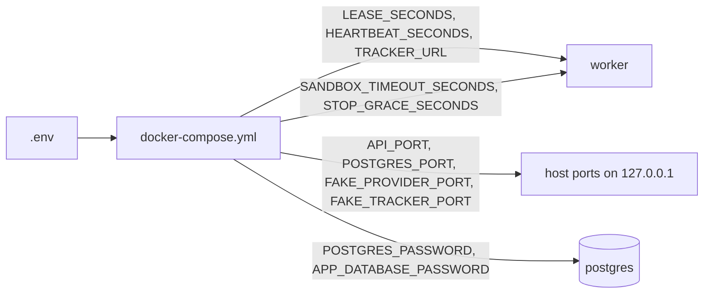
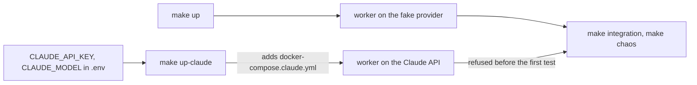

# Settings

Every service reads its settings from environment variables
(`src/runtime/config.py`). The compose file sets them for the stack, and
`.env` overrides the stack's defaults. Copy `.env.example` to start.

## From `.env` to a service

- The provider is not in this picture: `make up` always puts the worker on
  the fake. See [The Claude API](#the-claude-api).
- In `.env`, `API_PORT` is the host port the stack publishes the API on.
  Inside the container the API listens on `0.0.0.0:8000`.
- The stack publishes the API on 8000, Postgres on 5432, the fake provider
  on 8001 and the fake tracker on 8002, all on `127.0.0.1` only.

## The Claude API

The fake provider is the default, and the only provider the test suites
run against. The Claude API takes its own command.

- Only `docker-compose.claude.yml` reads `CLAUDE_API_KEY`, so the key can
  stay in `.env`. `CLAUDE_MODEL` defaults to `claude-haiku-5-5`.
- `make up-claude` ends by printing the worker's provider URL and model.
  A result from that stack names both.
- `scripts/check_fake_provider.py` does the refusing: it reads each
  worker's `ANTHROPIC_BASE_URL`, and never the whole environment.
- `make up` puts the worker back on the fake provider.

## Worker: job and provider

| Variable | Default | Meaning |
|---|---|---|
| `DATABASE_URL` | required | `postgresql://` URL without `sslmode`, also read by `api` and `migrate`. Names the [app role](database-roles.md) for `api` and `worker`. |
| `ANTHROPIC_BASE_URL` | the Claude API | Which provider to call. The stack sets the fake provider. |
| `ANTHROPIC_API_KEY` | required | The provider key. The fake accepts any value. |
| `MODEL` | required | Model for jobs that name none. With the fake provider, a scenario name. |
| `MAX_TOKENS` | 16000 | The most `max_tokens` a model call asks for |
| `LEASE_SECONDS` | 30 | How long a claim or a renewal holds a job |
| `HEARTBEAT_SECONDS` | 10 | Time between two renewals. Shorter than the lease. |
| `POLL_INTERVAL_SECONDS` | 1 | Wait between two looks for a job when none was found |
| `STOP_GRACE_SECONDS` | 75 | Time the worker gets after SIGTERM. Also the stack's `stop_grace_period`. |
| `WORKER_ID` | host name and process id | Stored as `lease_owner` |
| `WORKER_ALIVE_FILE` | `/tmp/worker.alive` | Touched every 5 seconds. The compose health check reads its age. |
| `TRACKER_URL` | unset | The tracker `create_issue` talks to. Unset, the tool is not offered. |

## Worker: workspace and sandbox

| Variable | Default | Meaning |
|---|---|---|
| `WORKSPACE_ROOT` | `/tmp/workspaces` | Parent of the job workspaces. The stack sets the shared volume at `/workspaces`. |
| `SWEEP_INTERVAL_SECONDS` | 300 | Time between two sweeps of `WORKSPACE_ROOT` |
| `SANDBOX_IMAGE` | unset | The image of the tool containers. Unset, `run_shell` and `list_dir` are not offered. |
| `SANDBOX_VOLUME` | required with `SANDBOX_IMAGE` | The named volume mounted at `WORKSPACE_ROOT` |
| `SANDBOX_TIMEOUT_SECONDS` | 30 | Time a sandboxed command may run. See [Sandbox](sandbox.md#time-bounds). |
| `SANDBOX_WORKSPACE_LIMIT_MIB` | 1024 | Soft size limit of a job's workspace. See [Sandbox](sandbox.md#workspace-size). |
| `SANDBOX_WORKSPACE_FILE_LIMIT` | 100000 | Files and directories a job's workspace may hold. Bounds each measurement. |
| `SANDBOX_WORKSPACE_POLL_SECONDS` | 1 | Seconds between two measurements of the workspace while a command runs |
| `GUARD_IMAGE` | unset | The image of a scoped call's guard, with nftables. Read only with `SANDBOX_IMAGE`. |
| `SANDBOX_NETWORK` | set with `GUARD_IMAGE` | The Docker network the guards join. Its subnet is in the deny list. |
| `SANDBOX_DENY_NETWORKS` | required with `GUARD_IMAGE` | Comma-separated Docker network names whose subnets no scope can reach |
| `DOCKER_SOCKET` | `/var/run/docker.sock` | The Docker Engine API socket. The stack mounts the host's socket there. |

- A workspace root belongs to one database: a worker removes the workspaces
  of jobs its database does not know.
- Without `GUARD_IMAGE`, a job with a scope gets an error result for each
  `run_shell` call.
- The stack builds `agent-runtime-sandbox:dev` and `agent-runtime-guard:dev`
  and sets both images.
- `DOCKER_GID` is the group of the host's Docker socket, added to the worker.
  `make` sets it. Every compose command needs it.

## API, CLI and the fakes

| Variable | Read by | Default | Meaning |
|---|---|---|---|
| `DEFAULT_TOKEN_BUDGET` | api | 1000000 | For a submission without `token_budget` |
| `DEFAULT_TIMEOUT_SECONDS` | api | 3600 | For a submission without `timeout_seconds` |
| `API_HOST`, `API_PORT` | api | `127.0.0.1`, `8000` | Where the API listens |
| `API_ALLOWED_HOSTS` | api | `localhost,127.0.0.1` | The names a request may use in `Host`. No ports, no wildcards, no IPv6. |
| `APP_DATABASE_PASSWORD` | migrate | required; the stack sets `runtime-app-dev` | Sets the login of `runtime_app`, the role of the API and the worker. In the stack's URLs too, so URL-safe characters only. |
| `RUNTIME_API_URL` | CLI | `http://127.0.0.1:8000` | Where the CLI finds the API |
| `RUNTIME_DATABASE_URL` | `runtime verify` | the stack's `runtime_app` on `127.0.0.1:5432` | The database whose step log it checks. The app role is enough. |
| `FAKE_SCENARIO_DIR` | fake-provider | scenarios in the package | Directory of scenario files |

The switches for failure tests (`FAILPOINT`, `FAILPOINT_TOOL`, `CHAOS_TOOLS`,
`CHAOS_LOG_DIR`) are in [Testing](testing.md#failure-switches).
