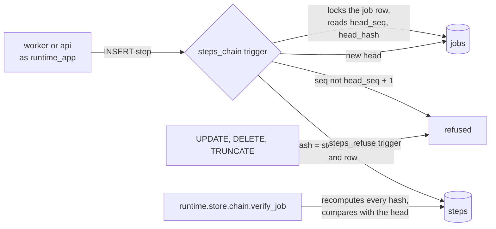

# The step log's hash chain

Every step carries a SHA-256 hash over the step before it and its own row.
The database makes the hash and refuses a change. A recomputation in Python
finds a change made by a role that switched the refusal off. The reasons are
in [ADR 0013](adr/0013-chain-the-step-log-and-split-the-database-roles.md).

## What is hashed

| Order | Field | Bytes |
|---|---|---|
| 1 | Hash of the step before; the job id for step 1 | 32; 16 |
| 2 | `job_id` | 16 |
| 3 | `seq`, `lease_epoch` | 4 each, big-endian, signed |
| 4 | `created_at` in microseconds since 1970 | 8 |
| 5 | Length of `kind`, then `kind` in UTF-8 | 4, then the length |
| 6 | `payload::text` in UTF-8 | the rest |

The time goes in as a number: as text it would depend on the session's time
zone. The payload goes in as Postgres prints `jsonb`, so the recomputation
reads that text and does not print JSON itself.

## Who is stopped by what

| Change | `runtime_app` | Owner, triggers on | Owner, triggers off |
|---|---|---|---|
| UPDATE, DELETE, TRUNCATE a step | No right | Refused by `steps_refuse` | Found by the recomputation |
| Insert a step out of order | Refused by `steps_chain` | Refused by `steps_chain` | Found |
| Cut the last steps | No right | Refused | Found at the head, unless the head is set back too |
| Write the head on the job row | No right | Allowed | Found |

- The app role may not write `head_seq` or `head_hash`, nor change a job's
  `id`. Its rights are on [Database roles](database-roles.md).
- A `seq` at or below the head reaches the primary key, so a second step
  with the same `seq` is refused as before, with the same error.
- The trigger refuses a step whose job does not exist yet, and runs on
  `steps` only. Only the owner may run the chain's functions.
- Each insert locks its job row until it commits. A claim skips the job
  meanwhile. The worker sends each step in autocommit, so this is one
  statement long.
- Migration 0007 hashed the steps that existed before it, in `seq` order.

## The recomputation

`verify_job` in `src/runtime/store/chain.py` takes a job id and returns what
does not match: a step whose hash differs, a gap in `seq`, or a head that is
not the last step. Each step is hashed from the stored hash before it, so a
changed step is named on its own. No command runs it yet: `runtime verify`
is planned.

## What it does not catch

- A role that can switch the triggers off, deletes the last steps and sets
  the head to the new last step. No hash has to be computed for that.
- The same role rewriting a step, every later hash and the head. Keeping the
  head outside the database is the follow-up for both.
- A restore of an older backup.
- A status change without a step, such as a cancel.
- A step whose content was false when it was written.
