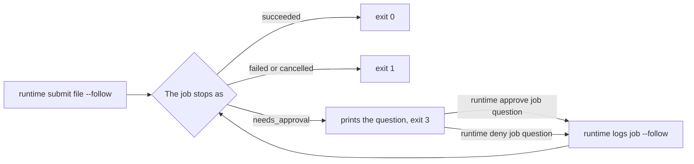

# Running jobs

The `runtime` CLI submits a job file to the API and follows the job. Start
the stack with `make up` first, as in the
[quickstart](../README.md#quickstart).



## Commands

| Command | What it does |
|---|---|
| `runtime submit <file> [--follow]` | Posts the job file. With `--follow`, prints each step until the job stops. |
| `runtime list [--status S] [--limit N] [--before ID]` | Jobs newest first, one line each. A job that waits shows its question under it. |
| `runtime status <job id>` | The job's status. `--json` prints the whole job. |
| `runtime logs <job id> [--follow]` | The job's steps, one short line each |
| `runtime answer <job id>` | A succeeded job's final answer, in full |
| `runtime approve <job id> <question>` | Lets the call a question asks about run once |
| `runtime deny <job id> <question>` | Refuses that call. The model gets an error result and the job goes on. |
| `runtime cancel <job id>` | Cancels the job |
| `runtime verify <job id>... \| --all` | Checks the [hash chain](step-log-chain.md) of the jobs' steps. Reads the database, not the API. |

Run them as `uv run runtime ...`. `RUNTIME_API_URL` says where the API is,
`RUNTIME_DATABASE_URL` where `verify` finds the database.

## Examples

| File | What the job does |
|---|---|
| `examples/hello.json` | Reads one file with `read_file` |
| `examples/shell.json` | Lists the workspace, reads a file with `cat` and writes a note, in the sandbox |
| `examples/ci-triage.json` | Reads a failed CI log and opens an issue in the fake tracker |
| `examples/approval.json` | The shell example with `"needs_approval": ["run_shell"]` |

The fake provider scripts the model's text. The tool calls and their results
are real. After the third example, `curl http://127.0.0.1:8002/issues` shows
the issue.

## A job that asks

```sh
uv run runtime submit examples/approval.json --follow
uv run runtime approve <job id> <question>
uv run runtime logs <job id> --follow
```

The first command stops when the job asks:

```text
needs_approval  tokens_used=1143
The job waits for a person to decide about a tool call.
  question: 7
  tool:     run_shell
  input:    {"command": "cat hello.txt && echo seen > note.txt && ls"}
  reason:   the job's spec asks for a person's approval before this tool runs
To let the call run: uv run runtime approve 01a1dc46-ae79-75d6-9dd9-070e7dc3e400 7
To refuse it:        uv run runtime deny 01a1dc46-ae79-75d6-9dd9-070e7dc3e400 7
```

- The question number is the `seq` of the question's step.
- The printed commands start with `uv run` when the CLI ran through it, so
  they work as copied.
- An answer to a question the job no longer waits on is refused and changes
  nothing.
- The `reason` says whether nothing has run yet, or a call was interrupted
  and may have run. See [Approval](approval.md#the-two-reasons-a-job-waits).
- A job nobody answers is failed at its deadline.
- `runtime list --status needs_approval` shows every job that waits, with
  its question. So does <http://127.0.0.1:8000/?status=needs_approval> in a
  browser, the [status page](api.md#status-page).
- With `NOTIFY_URL` set, the question is also posted there
  ([Approval](approval.md#ask-answer-run)).

## Job files

`runtime submit` posts a JSON file. Only `prompt` is required. Any field not
listed here is refused.

| Field | Meaning |
|---|---|
| `prompt` | The first user message. Not empty. |
| `system` | System prompt. Not empty if given. |
| `model` | Model id, by default the worker's `MODEL`. With the fake provider it names a scenario. |
| `files` | Text files for the job's workspace: relative path to content. 1 MiB in total. |
| `scope` | What `run_shell` may reach on the network. Left out: no network. |
| `needs_approval` | Names of tools whose calls wait for a person, at most 100 |
| `token_budget` | At least 1. Default: the API's `DEFAULT_TOKEN_BUDGET`. |
| `timeout_seconds` | 1 to 604800 (one week). Sets the job's deadline. |

- `files` paths are plain relative paths: no `..`, no `./`, no trailing `/`,
  and no path that is also a directory of another.
- `scope` is a list of targets, each `{"host": ..., "ports": [...]}`. See
  [Scope](scope.md#what-a-scope-can-hold).
- `needs_approval` adds to the tools whose own definition asks. See
  [Approval](approval.md#which-calls-are-asked-about).
- `token_budget` and the deadline are enforced as described in
  [Cancel, deadline and budget](halt.md).

## Tools

| Tool | Does | Offered when |
|---|---|---|
| `read_file` | Reads a text file of up to 64 KiB from the workspace | Always |
| `list_dir` | Lists a directory of the workspace, in a container | `SANDBOX_IMAGE` is set |
| `run_shell` | Runs a command with `/bin/sh` in the workspace, in a container | `SANDBOX_IMAGE` is set |
| `create_issue` | Opens an issue in the fake tracker or in Gitea, at `TRACKER_URL` | `TRACKER_URL` is set |

The stack sets both.

## Cancelling

`runtime cancel` cancels a job at once if no worker holds it. Otherwise its
worker stops it within a few seconds and kills a running tool command.
